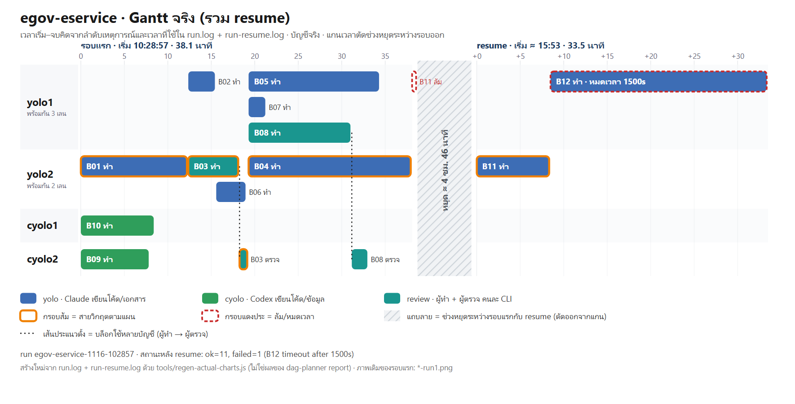
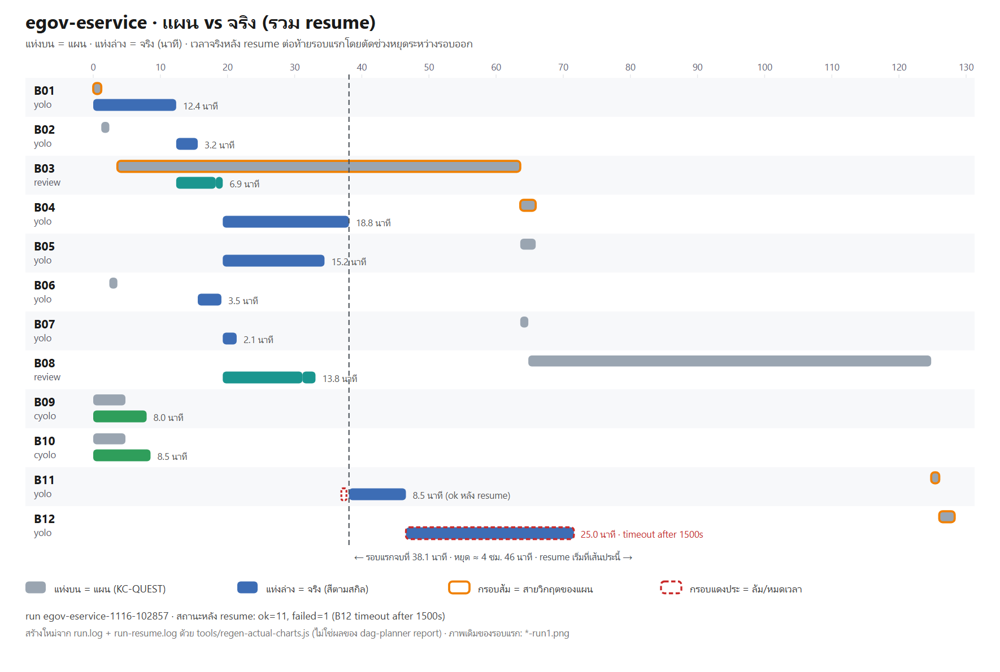

# REPORT egov-eservice

run `egov-eservice-1116-102857` · รันด้วยสกิล `dag-planner` + `agent-team` ใน container `multi-account`

## 1. สถานะสุดท้าย (รอบแรก + resume): ok 11 · failed 1

| บล็อก | สกิล | บัญชีแผน | บัญชีจริง | นาทีแผน | นาทีจริง | tokens in/out | สถานะ |
|---|---|---|---|---|---|---|---|
| B01 โครงโปรเจกต์+DB+hook | yolo | yolo2 | yolo2 | 1.2 | 12.36 | 76 / 73213 | ok |
| B02 Auth+RBAC+ลงทะเบียน | yolo | yolo2 | yolo1 | 1.2 | 3.21 | 52 / 21399 | ok |
| B03 ไลบรารีกฎธุรกิจ | review | yolo2 (ทำ) · cyolo1 (ตรวจ) | yolo2 (ทำ) · cyolo2 (ตรวจ) | 60.0 | 6.94 | 187208 / 36522 | ok (APPROVED รอบ 1) |
| B04 ฝั่งประชาชน ยื่น+จ่าย | yolo | yolo2 | yolo2 | 2.3 | 18.80 | 90 / 115154 | ok |
| B05 ฝั่งเจ้าหน้าที่/หัวหน้า | yolo | yolo2 | yolo1 | 2.3 | 15.16 | 114 / 97266 | ok |
| B06 เอกสารดิจิทัล+verify | yolo | yolo2 | yolo2 | 1.2 | 3.52 | 42 / 18797 | ok |
| B07 แจ้งเตือน+ยกเลิกอัตโนมัติ | yolo | yolo2 | yolo1 | 1.2 | 2.07 | 34 / 12558 | ok |
| B08 Dashboard+Audit+Admin | review | yolo2 (ทำ) · cyolo2 (ตรวจ) | yolo1 (ทำ) · cyolo2 (ตรวจ) | 60.0 | 13.81 | 393407 / 84747 | ok (APPROVED รอบ 1) |
| B09 Playwright ชุด A | cyolo | cyolo1 | cyolo2 | 4.8 | 7.96 | 1269298 / 24838 | ok |
| B10 Playwright ชุด B | cyolo | cyolo2 | cyolo1 | 4.8 | 8.54 | 1338646 / 26396 | ok |
| B11 UI responsive+a11y | yolo | yolo2 | รอบแรก yolo1 (ล้ม) → resume yolo2 | 1.2 | 8.48 | 70 / 35604 | **ok หลัง resume** · รอบแรกล้ม: `claude native binary not installed` |
| B12 รวม+รันเต็ม+BUG_MODE | yolo | yolo2 | resume yolo1 | 2.3 | 25.02 | 438 / 1540 | **failed: timeout after 1500s** |

- tokens รวม (รอบแรก + resume): input 3,189,475 · output 548,034
- เวลาที่ทีมทำงาน: รอบแรก 38.1 นาที (10:28:57 → 11:07) + resume 33.5 นาที (≈ 15:53 → 16:26) = **71.6 นาที** · แผน 128.3 นาที · ระหว่างสองรอบหยุด ≈ 4 ชม. 46 นาที (แก้ binary ใน container ด้วย `node install.cjs`)
- บัญชีจริงต่างจากแผนใน 7 บล็อกของรอบแรก (ผู้ทำ B02 B05 B07 B08 → yolo1 · B09/B10 สลับ cyolo1 ↔ cyolo2 · ผู้ตรวจ B03 → cyolo2): ตอนเริ่มรัน agent-team จัดบัญชีในฝั่งเดียวกันใหม่ตามโหลด/โควตา (บรรทัด `· แผน:` ใน `run.log`) · yolo2 หยุดรับงานเมื่อโควตาถึง 82% (เกณฑ์ 80%) เวลา 11:07:08 จึงย้าย B11 ไป yolo1

### ที่มาของตารางและภาพในข้อ 1

`dag-planner report` ถูกสั่งหลังรอบแรกเท่านั้น และ state ของ run ใน container (`/workspace/.agent-team/egov-eservice-1116-102857`) ไม่ได้ถูกเก็บออกมา จึงสั่ง `report` ซ้ำหลัง resume ไม่ได้
ตารางและภาพในข้อ 1 สร้างด้วย [`tools/regen-actual-charts.js`](tools/regen-actual-charts.js) ซึ่งอ่านข้อมูลจริงจาก [`run.log`](run.log) · [`run-resume.log`](run-resume.log) · `PLAN.md` · `blocks.json` (ไม่มีตัวเลขพิมพ์มือ)

| เรื่อง | รายละเอียด |
|---|---|
| เวลาที่ใช้ของแต่ละงาน · บัญชี · tokens · สถานะ | ค่าตรงจาก log (บรรทัด `✔` / `✘`) |
| เวลาเริ่มของแต่ละงาน | log ไม่มีเวลานาฬิการายงาน → คิดจากลำดับเหตุการณ์ (งานเริ่ม ณ เวลาที่เหตุการณ์จบก่อนหน้าเกิด) |
| ตรวจความถูกต้อง | ตำแหน่งแท่งของรอบแรกตรงกับภาพเดิมจากเครื่องมือ (`gantt-actual-run1.png`) · นาทีจริงต่างจากตารางของเครื่องมือในข้อ 3 ไม่เกิน 0.01 นาที · B04 จบตามที่คิดได้ 11:07:03 เทียบกับเหตุการณ์ย้ายงานที่ log บันทึกไว้ 11:07:08 (คลาดเคลื่อนสะสมราว 5–10 วินาที) |
| เวลาเริ่ม resume | ประมาณจากเวลาตรวจความพร้อมใน `run-resume.log` (15:52:52) |
| แกนเวลาของภาพ | ตัดช่วงหยุดระหว่างรอบออก (แถบลายใน Gantt · เส้นประใน compare) |

## 2. บล็อกที่ล้มและสาเหตุ

| บล็อก | อาการ | สาเหตุ | ทำอะไรต่อ |
|---|---|---|---|
| B11 (รอบแรก) | ล้มทันที 0.0 วินาที | `claude native binary not installed` บนบัญชี yolo1 ใน container · สาเหตุที่ binary หายยังไม่ทราบ | รัน `node install.cjs` ใน container แล้ว `resume` → B11 สำเร็จบน yolo2 ใน 508.8 วินาที |
| B12 (resume) | หมดเวลา 1500 วินาที (output เพียง 1,540 tokens) | **งานของบล็อกใหญ่เกินเพดานเวลาต่อบล็อก** (อนุมานจาก log ดูด้านล่าง) | ทำขั้นรวมต่อนอกทีมเอเจนต์ตามขั้น 4–5 ของ PROMPTS → [`FINAL-REPORT.md`](FINAL-REPORT.md) · [`BUG-HUNT.md`](BUG-HUNT.md) |

**ทำไม B12 จึงหมดเวลา (จัดเป็นแผนผิด ไม่ใช่เว็บผิด):** log ของเอเจนต์ B12 ไม่ได้เก็บออกมา จึงเป็นข้ออนุมานจากตัวเลขที่มี

- B12 ใช้เวลาครบ 1500 วินาทีแต่มี output เพียง 1,540 tokens → เวลาส่วนใหญ่หมดไปกับการรอคำสั่งที่รันนาน ไม่ใช่การเขียนโค้ด
- เกณฑ์เสร็จของ B12 คือ ประกอบเว็บ + รันชุดเต็ม 51 TC จนผ่าน + รัน `BUG_MODE` 12 ตัวและชุดรวม + จำแนกข้อที่ล้ม + เขียนรายงาน
- เฉพาะการรัน test ของ matrix 17 รอบ (ปกติ 3 · B01–B12 · ชุดรวม 2) ด้วย test ชุดเดิมใน container ใช้ราว 40–50 วินาทีต่อรอบ (`test-report/results/history/matrix-before-b03-fix.log`) คือ 12–14 นาที ยังไม่รวมเวลา restart เว็บด้วย docker compose ทุกรอบ การเขียน runner และการแก้ test ที่ล้ม
- ด้วย test ชุดปัจจุบัน (เติม assert ตามการ์ด) matrix อย่างเดียววัดได้ 19 นาทีกับ `node server.js` และ 48 นาทีกับ Docker Compose (รวมเวลาต่อรอบจาก `matrix-node.log` และ `matrix.log` ไม่รวมเวลา restart เว็บ)

แผนประเมิน B12 ไว้ 2.3 นาที (ขนาด L ของสกิล yolo) และเพดานของบล็อกคือ 25 นาที จึงต่ำกว่างานจริงมาก · ถ้ารันแผนนี้อีกครั้งควรแก้ที่แผน:

1. แยก B12 เป็นสองบล็อก: **B12a** รวม + รัน 51 TC จนผ่าน และ **B12b** รัน BUG_MODE matrix + triage (ทั้งคู่ `exclusive`)
2. ให้ B12b สั่ง `app/e2e/b12.sh` แบบ detach แล้วอ่านผลจาก `matrix.log` แทนการรอในเทิร์นเดียว หรือเพิ่มเพดานเวลาของบล็อกรวม
3. ปรับ k ของบล็อกที่ต้องรัน test ซ้ำหลายรอบแยกจาก k ของงานเขียนโค้ด

ขั้นรวมทั้งหมดของ B12 ทำซ้ำได้ด้วยคำสั่งเดียว: `bash app/e2e/b12.sh` (build image → matrix 17 รอบ → ตาราง BUGS.md §4 → ออกด้วยรหัส 0 เมื่อผลตรงตาราง)

## 3. รายงานเดิมจาก `dag-planner report` (หลังรอบแรก · คงไว้ตามที่เครื่องมือสร้าง)

run `egov-eservice-1116-102857` · สถานะ state.json: blocked=1, failed=1, ok=10

| บล็อก | สกิล | บัญชีแผน | บัญชีจริง | นาทีแผน | นาทีจริง | tokens in/out (ledger) | สถานะ |
|---|---|---|---|---|---|---|---|
| B01 โครงโปรเจกต์+DB+hook | yolo | yolo2 | yolo2 | 1.2 | 12.37 | 76 / 73213 | ok |
| B02 Auth+RBAC+ลงทะเบียน | yolo | yolo2 | yolo1 | 1.2 | 3.2 | 52 / 21399 | ok |
| B03 ไลบรารีกฎธุรกิจ | review | cyolo1, yolo2 | cyolo2, yolo2 | 60.0 | 6.93 | 187208 / 36522 | ok |
| B04 ฝั่งประชาชน ยื่น+จ่าย | yolo | yolo2 | yolo2 | 2.3 | 18.8 | 90 / 115154 | ok |
| B05 ฝั่งเจ้าหน้าที่/หัวหน้า | yolo | yolo2 | yolo1 | 2.3 | 15.15 | 114 / 97266 | ok |
| B06 เอกสารดิจิทัล+verify | yolo | yolo2 | yolo2 | 1.2 | 3.52 | 42 / 18797 | ok |
| B07 แจ้งเตือน+ยกเลิกอัตโนมัติ | yolo | yolo2 | yolo1 | 1.2 | 2.08 | 34 / 12558 | ok |
| B08 Dashboard+Audit+Admin | review | cyolo2, yolo2 | cyolo2, yolo1 | 60.0 | 13.82 | 393407 / 84747 | ok |
| B09 Playwright ชุด A | cyolo | cyolo1 | cyolo2 | 4.8 | 7.97 | 1269298 / 24838 | ok |
| B10 Playwright ชุด B | cyolo | cyolo2 | cyolo1 | 4.8 | 8.53 | 1338646 / 26396 | ok |
| B11 UI responsive+a11y | yolo | yolo2 | yolo1 | 1.2 | 0.0 | 0 / 0 | failed: Error: claude native binary not installed. Either postinstall did not run (--ign |
| B12 รวม+รันเต็ม+BUG_MODE | yolo | yolo2 | - | 2.3 | - | 0 / 0 | blocked: งานที่ต้องรอ B11 ล้ม/ไม่ผ่าน จึงไม่รัน |

รวม tokens: input 3188967 · output 510890 (รวมจาก ledger ของ run)

### ตัวปรับ k (เวลาจริง ÷ เวลาแผน แยกตามสกิล)

| สกิล | k ใหม่ | จำนวนบล็อกที่ใช้ |
|---|---|---|
| cyolo | 0.222 | 2 |
| review | 0.173 | 2 |
| yolo | 0.551 | 6 |

บันทึกลง `/workspace/plans/calib.json` · `plan` ครั้งถัดไปใช้ค่านี้ (ค่า k นี้คิดจากรอบแรก ไม่ได้ปรับหลัง resume)

ภาพของรอบแรกจากเครื่องมือ (เปลี่ยนชื่อไฟล์เพื่อเก็บไว้): [`gantt-actual-run1.png`](gantt-actual-run1.png) · [`compare-run1.png`](compare-run1.png)
